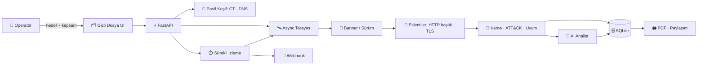

<!-- ═══════════════════════════════ BAŞLIK ═══════════════════════════════ -->
<div align="center">



<a href="https://github.com/Pireburak">
  
</a>


<a href="https://github.com/Pireburak?tab=followers"></a>
<a href="https://github.com/Pireburak?tab=repositories"></a>
<a href="https://github.com/Pireburak/ReconClaw"></a>

</div>

<!-- ═══════════════════════════════ WHOAMI ═══════════════════════════════ -->

## `> whoami`

```bash
┌──(pireburak㉿kali)-[~]
└─$ whoami
burak — security-minded software engineer

┌──(pireburak㉿kali)-[~]
└─$ cat about.txt
[+] Sistemleri nasıl kırıldıklarını anlayarak tasarlıyorum.
[+] Keşif → risk skoru → ATT&CK saldırı zinciri → KVKK uyumu → aksiyon planı.
[+] Saldırı yüzeyi yönetimi, mobil runtime analizi ve kurumsal ağ güvenliği üzerine çalışıyorum.
[+] Yakıt: demli çay. Menşei: Anadolu. Pusula: bilim.

┌──(pireburak㉿kali)-[~]
└─$ cat /etc/motto
"If you can't break it, you can't secure it."
```

<table>
<tr>
<td width="50%" valign="top">

### 🎯 Şu an
- 🦝 **ReconClaw v9.0 Cortex**: canlıya hazırlık (ödeme altyapısı, yasal sayfalar, bot koruması)
- 🏆 ReconClaw için **TÜBİTAK / TEKNOFEST** proje dosyası
- 📱 **Android runtime injection**: Frida, ADB, MobSF ile mobil analiz
- 🌐 **Kurumsal ağ tasarımı**: VLAN segmentasyonu, QoS, NGFW kuralları

</td>
<td width="50%" valign="top">

### 🧬 Profil
```yaml
alias:     Pireburak
location:  Türkiye 🇹🇷
focus:     [Recon, ASM, ATT&CK, Mobile, Network]
languages: [Python, Rust, C++, Bash, JS]
os:        Kali Linux
çay:       ████████████ 100%
```

</td>
</tr>
</table>



<!-- ═══════════════════════════════ ATATÜRK ═══════════════════════════════ -->

## `> cat /etc/pusula`

<div align="center">
  
</div>

<!-- ═══════════════════════════════ ARSENAL ═══════════════════════════════ -->

## `> ls ~/arsenal`

<div align="center">

**⚙️ Çekirdek & Backend**


**🛡️ Güvenlik Cephaneliği**


<br/>


**🌐 Altyapı & Önyüz**


<br/>


</div>

<!-- ═══════════════════════════════ RECONCLAW ═══════════════════════════════ -->

## `> ./featured --project ReconClaw`

<div align="center">
  <a href="https://github.com/Pireburak/ReconClaw">
    
  </a>
</div>

> **🦝 Asenkron ağ keşfi, sürekli saldırı yüzeyi izleme ve yapay zekâ destekli risk analiz platformu.**
> Bir hedef verirsin; ReconClaw portları yoklar, servis sürümlerini yakalar, bilinen zafiyetlerle eşler, **A+…F güvenlik notu** verir, bulguları **MITRE ATT&CK** saldırı zincirine ve **ISO 27001 / KVKK** kontrollerine bağlar ve **AI Analist** ile ne yapman gerektiğini Türkçe anlatır.

| 🔧 Katman | 📡 Ne yapar | ⚡ Nasıl |
| --- | --- | --- |
| **Hızlı keşif** | Yüzlerce portu aynı anda, hedefi boğmadan yoklar | `asyncio` + eşzamanlılık sınırı |
| **Sürüm & CVE** | Banner'dan sürüm yakalar, bilinen zafiyet imzalarıyla eşler | banner grabbing + CVE imzaları |
| **Güvenlik karnesi** | 5 kategoride puan, kritik sorunda not tavanı | deterministik, testli kurallar |
| **MITRE ATT&CK** | 14 taktiklik matris ve olası saldırı zinciri | `core/intel.py` |
| **Uyum** | ISO/IEC 27001:2022 Ek A (8 kontrol) + KVKK m.12 ön değerlendirmesi | kanıtlı sınıflandırma |
| **AI Analist** | Yönetici özeti, P1/P2/P3 aksiyon planı, rapor üzerine soru-cevap | Claude + çevrimdışı kural tabanlı yedek |
| **Sürekli izleme** | Saatlik / günlük / haftalık tarama, değişim alarmı | zamanlayıcı + Discord / Slack webhook |
| **Pasif keşif** | Hedefe paket göndermeden alt alan adları, SPF / DMARC / CAA puanı | Sertifika Şeffaflığı + DNS-over-HTTPS |
| **Raporlama** | GİZLİ damgalı PDF, CSV / JSON, salt-okunur paylaşım bağlantısı | 192 bit rastgele anahtar |
| **Yayın** | Çok kullanıcılı, e-posta ve sosyal giriş, tek komutla HTTPS | Docker + Caddy |

<details>
<summary><b>🖼️ Ekran turu (tıkla)</b></summary>
<br/>

<p align="center">
  
</p>

| 🅰️ Güvenlik karnesi | 🎯 MITRE ATT&CK |
| --- | --- |
|  |  |

<p align="center">
  
</p>

</details>

<details>
<summary><b>🧩 ReconClaw mimarisi (tıkla)</b></summary>
<br/>



</details>

<details>
<summary><b>📜 <code>git log --oneline reconclaw</code> (tıkla)</b></summary>
<br/>

```diff
+ v9.0 Cortex    gerçek ödeme altyapısı, yasal sayfalar, şifremi unuttum, gerçek IP tespiti
+ v8.2 Cortex    bot koruması: Turnstile + bal küpü alanı + hız sınırı
+ v8.1 Cortex    Türkiye / yurt dışı bölgesel fiyat
+ v8.0 Cortex    MITRE ATT&CK, A+…F karne, ISO 27001 / KVKK uyumu, AI Analist, paylaşım
+ v7.0 Sentinel  sürekli izleme, pasif keşif, hesap etkinliği
+ v6.x Aurora    "gizli dosya" arayüzü, komut paleti, abonelik planları, hedef doğrulama
+ v5.0 Nebula    operasyon paneli, çoklu kullanıcı, karşılaştırma, ağ haritası, PDF
+ v4.0 Phantom   modüler mimari, async motor, banner grabbing, eklenti sistemi
* v1–v3          ilk TCP tarayıcı, CLI, dashboard, risk motoru
```

</details>

<!-- ═══════════════════════════════ PROJELER ═══════════════════════════════ -->

## `> ls ~/projeler`

<div align="center">

<a href="https://github.com/Pireburak/Finalproject_MacOS"></a>
<a href="https://github.com/Pireburak/miterm-Burak-Ozdemir"></a>
<a href="https://github.com/Pireburak/OSINT-veritabani"></a>

</div>

| 📂 Proje | 🔍 Odak | 🧾 Öne çıkan çıktı |
| --- | --- | --- |
| **WebKit UAF analizi** | Zafiyet araştırması | CVE-2026-3312 için CVSS 8.8 analizi, `unsafe` Rust ile UAF simülasyonu, interaktif HTML simülasyon paneli, C++ yama önerileri |
| **Rust ağ tarayıcı** | Keşif aracı | Port tarama, banner yakalama, DNS, HTTP başlık ve dizin keşfi modülleri; CI/CD ve Docker |
| **OSINT veritabanı** | Tehdit istihbaratı | NVD, Exploit-DB, The Hacker News ve BleepingComputer akışlarını toplayıp konuya göre sınıflandırma; 4 farklı LLM ile araştırma karşılaştırması |

<details>
<summary><b>🧪 Lab notları (tıkla)</b></summary>
<br/>

| 🔒 Lab | 🧰 Araçlar | 🧾 Öne çıkan çıktı |
| --- | --- | --- |
| **Android Runtime Injection** | Frida, ADB, MobSF, mitmproxy, Docker Android | Runtime injection ile SSL pinning ve root tespiti atlatma mantığı; yönetici yetkisi olmayan okul ortamında Alpine + taşınabilir VirtualBox ile kurulum |
| **Ağ Segmentasyonu & Firewall** | NGFW (FortiGate / Palo Alto / pfSense), IPsec | Hayali **AnadoluNet** holdingi: 4 şube, ~9.100 kullanıcı, VLAN / IP planı, formülle bant genişliği hesabı ve QoS, 14 adımlık güvenlik duvarı kurulumu, IKEv2 site-to-site VPN, default-deny kural tabloları |

<sub>🔒 Lab notları özel repolarda tutuluyor.</sub>

</details>

<!-- ═══════════════════════════════ İSTİKBAL GÖKLERDEDİR ═══════════════════════════════ -->

## `> ./istikbal --goklerdedir`

<div align="center">
  
</div>

TEKNOFEST'te sabahlayan takımlar, BAYKAR'ın **Bayraktar TB2**, **AKINCI** ve **KIZILELMA**'sı, "yapamazsınız" denen her şeyin Anadolu'da yapılabildiğinin kanıtı.
Benim cephem siber: gökteki her İHA'nın arkasında **şifreli bir veri bağı**, **sağlamlaştırılmış bir yer istasyonu** ve güvenli yazılmış bir kod satırı var. ReconClaw'ın **TÜBİTAK / TEKNOFEST** proje dosyası da bu yolda hazırlanıyor. 🛡️✈️

<!-- ═══════════════════════════════ METHODOLOGY ═══════════════════════════════ -->

## `> cat methodology.md`

<div align="center">
  
</div>

<details>
<summary><b>📜 Prensiplerim</b></summary>
<br/>

```diff
+ Kapsam yazılı değilse, tarama yok.
+ Her bulgu bir düzeltme önerisiyle gelir.
+ Otomasyon hız kazandırır, doğrulama güven kazandırır.
+ Skoru kurallar hesaplar, yapay zekâ yalnızca yorumlar.
+ Taranan sunucudan gelen veri, talimat değil veridir (prompt injection).
+ Güvenli varsayılanlar > sonradan yamalar.
- "Security through obscurity" bir strateji değildir.
```

</details>

<!-- ═══════════════════════════════ SİBER SÖZLÜK ═══════════════════════════════ -->

## `> man siber-sozluk`

Güvenlik Türkçe de konuşulur. Terimlerin Türkçesini kullanmaya özen gösteriyorum:

<details>
<summary><b>📖 Türkçe siber güvenlik sözlüğü (tıkla)</b></summary>
<br/>

| 🇹🇷 Türkçe | 🇬🇧 English | 💬 Tek cümlede |
| --- | --- | --- |
| **Keşif** | Reconnaissance | Hedefi tanımadan hiçbir şeye dokunma. |
| **Saldırı yüzeyi** | Attack surface | Dışarıdan ulaşılabilen her kapı, her servis. |
| **Parmak izi çıkarma** | Fingerprinting | Hangi servis, hangi sürüm, hangi işletim sistemi? |
| **Zafiyet** | Vulnerability | Sistemdeki zayıf nokta. |
| **İstismar** | Exploit | O zayıf noktayı kullanan kod ya da teknik. |
| **Sıfırıncı gün açığı** | Zero-day | Üreticinin henüz haberi olmayan zafiyet. |
| **Serbest bırakıldıktan sonra kullanım** | Use-after-free | Silinmiş belleğe erişmeye devam etmek. |
| **Sertifika sabitleme** | Certificate pinning | Uygulamanın yalnızca belirli sertifikaya güvenmesi. |
| **Sızma testi** | Penetration test | İzinli saldırı, gerçek rapor. |
| **Oltalama** | Phishing | Tatlı dil, sahte link, gerçek kayıp. |
| **Fidye yazılımı** | Ransomware | Dosyalarını şifreler, fidye ister. Yedek al. |
| **İstem enjeksiyonu** | Prompt injection | Veri kılığında yapay zekâya talimat kaçırmak. |
| **Bal küpü** | Honeypot | Saldırganı oyalayan, onu izleyen tuzak sistem. |
| **Güvenlik duvarı** | Firewall | Kapıdaki bekçi. |
| **En az yetki ilkesi** | Least privilege | Gerektiği kadar yetki, fazlası değil. |

</details>

<!-- ═══════════════════════════════ TR BİLİŞİM TARİHİ ═══════════════════════════════ -->

## `> git log --oneline turkiye/bilisim`

```diff
+ (staged)  pireburak: sıradaki commit Anadolu'dan geliyor 🚀
* 2025  Siber Güvenlik Başkanlığı kuruldu · 7545 sayılı Siber Güvenlik Kanunu kabul edildi
* 2022  Bayraktar KIZILELMA ilk uçuşunu yaptı — insansız savaş uçağı çağı başladı
* 2019  Bayraktar AKINCI ilk uçuşunu yaptı
* 2018  İlk TEKNOFEST düzenlendi — milli teknoloji hamlesi sahaya indi
* 2016  6698 sayılı KVKK yürürlüğe girdi — kişisel veri artık kanunla korunuyor
* 2013  USOM (Ulusal Siber Olaylara Müdahale Merkezi) kuruldu
* 1993  12 Nisan: ODTÜ üzerinden Türkiye'nin ilk internet bağlantısı kuruldu
* 1960  Türkiye'nin ilk bilgisayarı IBM 650, Karayolları Genel Müdürlüğü'nde çalıştı
```

<details>
<summary><b>☕ <code>systemctl status cay.service</code> (tıkla)</b></summary>
<br/>

```bash
┌──(pireburak㉿kali)-[~]
└─$ systemctl status cay.service
● cay.service - Türk Çayı Demleme Servisi (Rize, çift katlı çaydanlık)
     Loaded: loaded (/etc/systemd/system/cay.service; enabled; preset: tavşan kanı)
     Active: active (demleniyor) since 07:00 +03; her gün, tatil yok
    Process: ince belli bardak · şeker opsiyonel · bardak altlığı zorunlu
     Memory: ☕ × ∞
     CGroup: /mutfak.slice/cay.service
             ├─ demlik     (üst kat)  — 15 dk demlenir, acele edilmez
             └─ çaydanlık  (alt kat)  — su hep kaynar

07:00:01 kali systemd[1]: Started Türk Çayı Demleme Servisi.
07:15:00 kali cay[1923]: [+] Demlendi. Renk kontrolü: tavşan kanı ✓
10:30:12 kali cay[1923]: [!] Bardak boş — auto-refill tetiklendi.
16:00:00 kali cay[1923]: [+] İkindi çayı + simit modu aktif. 🥯
02:14:59 kali cay[1923]: [~] Gece mesaisi: exploit analizi + son demlik.
```

</details>

<!-- ═══════════════════════════════ ATASÖZÜ ═══════════════════════════════ -->

## `> fortune tr-atasozleri`

Her gece İstanbul saatiyle bir atasözü seçilir ve bir güvenlik dersiyle yorumlanır (GitHub Actions ⚙️):

<!-- ATASOZU:START -->
```bash
┌──(pireburak㉿kali)-[~]
└─$ fortune tr-atasozleri --gun 302
📜  "Sakla samanı, gelir zamanı."
🛡️  └─> Logları sakla; olay müdahalesinde hepsi lazım olur.
```
<sub>🕰️ Son güncelleme: 29.10.2026 · İstanbul saatiyle her gece otomatik yenilenir.</sub>
<!-- ATASOZU:END -->

<!-- ═══════════════════════════════ ROADMAP ═══════════════════════════════ -->

## `> cat roadmap.todo`

**✅ Tamamlananlar**
- [x] ReconClaw v7.0 Sentinel: sürekli izleme ve pasif keşif
- [x] ReconClaw v8.0 Cortex: MITRE ATT&CK, A+…F karne, ISO 27001 / KVKK, AI Analist
- [x] ReconClaw v9.0 Cortex: ödeme altyapısı, yasal sayfalar, bot koruması
- [x] Docker + Caddy ile tek komutla HTTPS yayın
- [x] PDF / CSV / JSON rapor ve eklenti sistemi
- [x] WebKit use-after-free (CVE-2026-3312) analizi ve Rust simülasyonu
- [x] Kurumsal ağ segmentasyonu ve güvenlik duvarı tasarımı

**🔭 Sıradakiler**
- [ ] ReconClaw: iki adımlı doğrulama (TOTP)
- [ ] ReconClaw: CIDR aralığı ve UDP tarama
- [ ] ReconClaw: NVD / OSV + EPSS ile CVE zenginleştirme
- [ ] ReconClaw: Türkçe / İngilizce arayüz, SIEM entegrasyonu
- [ ] Android lab: Frida ile canlı SSL pinning bypass
- [ ] TÜBİTAK / TEKNOFEST başvurusu


<!-- ═══════════════════════════════ STATS ═══════════════════════════════ -->

## `> ./stats --verbose`

<div align="center">


<sub>Tüm kartlar dış servis kullanmadan, bu repodaki <code>scripts/profil.py</code> ile her gece yeniden dokunur.</sub>

</div>

<!-- ═══════════════════════════════ CONNECT ═══════════════════════════════ -->

## `> ping pireburak`

```
PING pireburak (127.0.0.1): 56 data bytes
64 bytes from pireburak: icmp_seq=0 ttl=64 — güvenlik aracı? backend mimarisi? iş birliği?
64 bytes from pireburak: icmp_seq=1 ttl=64 — ReconClaw'ı denemek ya da katkı vermek mi istiyorsun?
64 bytes from pireburak: icmp_seq=2 ttl=64 — kanallar açık, bir çay söyle, yaz 👇
```

<div align="center">

<a href="mailto:burak4234@outlook.com"></a>

<a href="https://github.com/Pireburak"></a>

<br/><br/>

<sub>⚠️ Buradaki tüm araçlar yalnızca <b>yetkili</b> testler ve eğitim amaçlıdır; izinsiz tarama TCK 243–245 kapsamında suç teşkil edebilir. / For authorized testing & education only.</sub>

<br/><br/>



</div>
